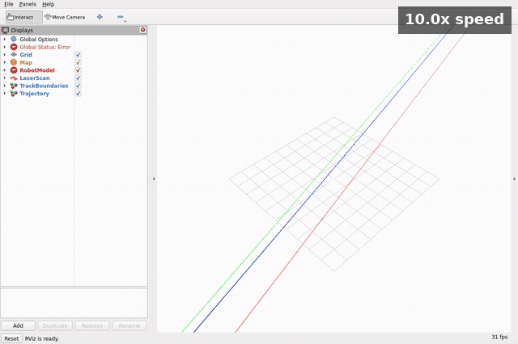

# GR-roboracer

An autonomous racing software stack for the F1TENTH / RoboRacer platform, on ROS 2 Jazzy.

The goal is a vehicle that laps a track quickly and provably safely, with a development
loop that checks the claim automatically. Seeded runs through the real launch produce
metrics records compared against a committed golden baseline, so changes in speed,
tracking and wall clearance are visible in the tests.

## Demonstration

The demonstration is a Spielberg lap on the committed minimum-curvature raceline
(`optimized_raceline`, optimizer `tum_mincurv_iqp`), at the line's own speed, with pure pursuit
control and an independent safety supervisor. The vehicle drives on ground-truth pose; the
acceptance test SIM-3110 verifies that this seeded lap completes with zero collisions.

▶ [Watch the full video (Google Drive)](https://drive.google.com/file/d/1jyuSPOSun9hCTo3B2k7AFhTbSG5BWP-h/view):
the complete lap at 4.0x simulated time (the preview above plays at 10.0x). Recorded with `ros2 launch racing_bringup sim_pure_pursuit.launch.py scenario:=config/scenarios/spielberg.yaml planner:=optimized_raceline raceline_optimizer:=tum_mincurv_iqp speed_source:=trajectory seed:=42`
on `config/scenarios/spielberg.yaml`, seed 42, at commit `abb22f2`.
Earlier videos, including the AMCL closed-loop lap, are in [demonstrations](docs/demonstrations.md).

## Capabilities and roadmap

Available means a supported current workflow or tool. In development means active
implementation; Planned means settled future work; Exploratory means research.
Roadmap entries are directions to investigate or build, with no runnable workflow yet.

| Group | Method | Status | Scope |
|---|---|---|---|
| Simulation | [`f1tenth_gym_jax`](docs/workflows/racing.md#simulation) | Available | ROS 2 simulation and headless JAX rollouts. |
| Simulation | AutoDRIVE | In development | Future simulation workflow for mapped tracks without ground-truth centerlines. |
| Mapping and SLAM | [SLAM Toolbox survey mapping](docs/workflows/mapping.md#survey-mapping) | Available | Builds a map while the vehicle drives on ground truth. |
| Mapping and SLAM | FAR-LIO / LiDAR-inertial methods | Exploratory | Research direction; no current implementation. |
| Localization | [`ground_truth`](docs/workflows/racing.md#ground-truth-reference-stack) | Available | Exact simulator pose in the reference stack. |
| Localization | [`slam_toolbox`](docs/workflows/racing.md#online-slam-toolbox-evaluation) | Available | Online estimate evaluation while driving on ground truth; driving on its estimate latches a `TRACK_LIMIT` stop. |
| Localization | [`amcl`](docs/workflows/racing.md#amcl-closed-loop) | Available | Saved-map localization and verified closed-loop driving on Spielberg. |
| Localization | [`mola`](docs/workflows/racing.md#mola-open-loop) | Available | MOLA-LO lidar localization on the map MOLA built itself, scored open loop on Spielberg (1080 beams, 1x); no closed-loop lap is backed. |
| Planning and raceline generation | [`track_centerline`](docs/workflows/racing.md#planning-and-raceline-generation) | Available | Default runtime planner (`planner:=track_centerline`): publishes the centerline at constant speed. Renamed from `track_raceline`. |
| Planning and raceline generation | [Offline centerline extraction and TUM minimum-curvature and minimum-time wrappers](docs/workflows/racing.md#planning-and-raceline-generation) | Available | Offline command `python -m raceline` (needs `--vehicle`, `--optimizer` and `--track` or `--map`; `--map` also needs `--start-pose` and `--direction`; full command and flags in [raceline/README.md](raceline/README.md#racelines-part-4)); min-curvature (`tum_mincurv_iqp`) and minimum-time (`tum_mintime`, on the owner's TUM fork) racelines committed under `config/racelines/spielberg/`; the stack races them through `optimized_raceline` below. |
| Planning and raceline generation | [`optimized_raceline`](docs/workflows/racing.md#planning-and-raceline-generation) (racing integration) | Available | Selectable with `planner:=optimized_raceline speed_source:=trajectory`; follows the committed line chosen by `raceline_optimizer:=`: `tum_mincurv_iqp` (the default) laps Spielberg in 113.08 s and `tum_mintime` in 112.12 s, against 120.41 s for the centerline lap on the curvature schedule (seed 42, ground truth; see [path planning](docs/path-planning.md)). Only the default-vehicle line has a gate lap; [issue #12](https://github.com/G-S-Rodrigues/GR-roboracer/issues/12) stays open for the remaining stages. |
| Control | [`pure_pursuit`](docs/workflows/racing.md#control) | Available | Baseline controller with independent safety; by default ignores trajectory speed; `speed_source=trajectory` follows it (a constant 1.0 m/s in the published `<map>_raceline.csv`, which is the centerline; the line's own speed on a committed raceline), set by the launch argument `speed_source:=trajectory` or in the vehicle file, the argument winning; `lookahead_gain` defaults to 0 and is a vehicle-file parameter; opt-in is in [racing.md](docs/workflows/racing.md#control). |
| Control | Tracking/dynamic MPC and MPCC | Exploratory | Controller research directions. |
| Learning-based methods | Trajectory-conditioned or residual control | Exploratory | Learned control around a trajectory or classical controller. |
| Learning-based methods | Localization/state estimation | Exploratory | Learned components inside a structured estimator. |
| Learning-based methods | End-to-end sensor-to-command driving | Exploratory | Learned mapping from observations to driving commands. |

The three learning directions may use reinforcement, imitation, supervised or
self-supervised learning. No learned implementation or training pipeline is available
yet. Classical implementations remain available as new methods are added, and the
independent safety supervisor remains part of the driving stack.

## Quick Start and guides

Start with [Quick Start](docs/quick-start.md) to set up the environment and run a
supported scenario. Then use the guides for the task at hand:

- [Configuration](docs/configuration.md): tracks, vehicle parameters and implementation selection.
- [Mapping](docs/workflows/mapping.md#survey-mapping): generate a survey map.
- [Racing](docs/workflows/racing.md#simulation): run and inspect the available implementations.
- [Results](docs/results.md): understand the measurements and current evidence.
- [Verification](docs/verification.md): reproduce the public checks.
- [Path planning](docs/path-planning.md): ground-truth centerline, survey map, extracted centerline and the minimum-curvature raceline compared.

## Licence

MIT — see [LICENSE](LICENSE).
