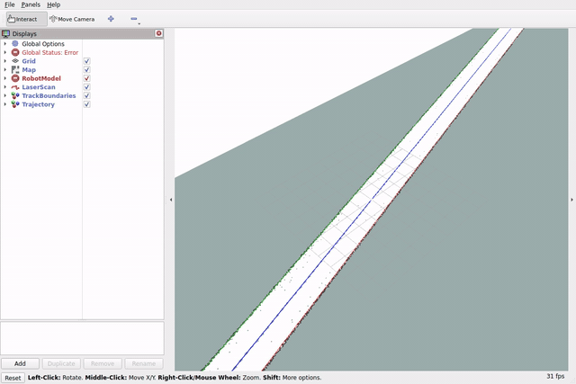

# GR-roboracer

An autonomous racing software stack for the F1TENTH / RoboRacer platform, on ROS 2 Jazzy.

The goal is a vehicle that laps a track quickly and provably safely, with a development
loop that checks the claim automatically. Seeded runs through the real launch produce
metrics records compared against a committed golden baseline, so changes in speed,
tracking and wall clearance are visible in the tests.

## Demonstration

The demonstration uses AMCL on the saved Spielberg survey map, pure pursuit control
and an independent safety supervisor. The map is generated survey output: the vehicle
drives on ground truth while SLAM Toolbox builds it. AMCL then drives in closed loop
on its own estimate; the existing acceptance case verifies a completed lap with zero
collisions.

Preview at 9.8x playback; full recording (H.264, complete lap): [Google Drive](https://drive.google.com/file/d/1PiRinnzqWcYsrCz1xnA7K2JKh43zbPqP/view), played at 3.9x simulated
time. Recorded with `ros2 launch racing_bringup sim_pure_pursuit.launch.py scenario:=config/scenarios/spielberg.yaml pose_source:=amcl drive_on_estimate:=true seed:=42`
on `config/scenarios/spielberg.yaml`, seed 42, at commit `cadfdd5`.

## Capabilities and roadmap

Available means a supported current workflow or tool. In development means active
implementation; Planned means settled future work; Exploratory means research.
Roadmap entries are directions to investigate or build, with no runnable workflow yet.

| Group | Method | Status | Scope |
|---|---|---|---|
| Simulation | [`f1tenth_gym_jax`](docs/workflows/racing.md#simulation) | Available | ROS 2 simulation and headless JAX rollouts. |
| Simulation | AutoDRIVE | Planned | Future simulation workflow for mapped tracks without ground-truth centerlines. |
| Mapping and SLAM | [SLAM Toolbox survey mapping](docs/workflows/mapping.md#survey-mapping) | Available | Builds a map while the vehicle drives on ground truth. |
| Mapping and SLAM | FAR-LIO / LiDAR-inertial methods | Exploratory | Research direction; no current implementation. |
| Localization | [`ground_truth`](docs/workflows/racing.md#ground-truth-reference-stack) | Available | Exact simulator pose in the reference stack. |
| Localization | [`slam_toolbox`](docs/workflows/racing.md#online-slam-toolbox-evaluation) | Available | Online estimate evaluation while driving on ground truth; driving on its estimate latches a `TRACK_LIMIT` stop. |
| Localization | [`amcl`](docs/workflows/racing.md#amcl-closed-loop) | Available | Saved-map localization and verified closed-loop driving on Spielberg. |
| Planning and raceline generation | [`track_raceline`](docs/workflows/racing.md#planning-and-raceline-generation) | Available | Current runtime planner publishes the centerline at constant speed. |
| Planning and raceline generation | [Offline centerline extraction and TUM minimum-curvature wrapper](docs/workflows/racing.md#planning-and-raceline-generation) | Available | Offline command `python -m raceline` (needs `--vehicle`, `--optimizer` and `--track` or `--map`; `--map` also needs `--start-pose` and `--direction`; full command and flags in [raceline/README.md](raceline/README.md#racelines-part-4)); min-curvature racelines committed under `config/racelines/spielberg/`; nothing follows them yet; minimum-time optimization has not converged. |
| Planning and raceline generation | Optimized raceline racing integration | In development | [Issue #12](https://github.com/G-S-Rodrigues/GR-roboracer/issues/12) remains open; see [path planning](docs/path-planning.md); [PR #17](https://github.com/G-S-Rodrigues/GR-roboracer/pull/17) merged the offline seam. |
| Control | [`pure_pursuit`](docs/workflows/racing.md#control) | Available | Baseline controller with independent safety; by default ignores trajectory speed; the opt-in node parameter `speed_source=trajectory` follows it (a constant 1.0 m/s in the published `<map>_raceline.csv`, which is the centerline), and `lookahead_gain` defaults to 0; opt-in is in [racing.md](docs/workflows/racing.md#control). |
| Control | Tracking/dynamic MPC and MPCC | Exploratory | Controller research directions. |
| Learning-based methods | Trajectory-conditioned or residual control | Exploratory | Learned control around a trajectory or classical controller. |
| Learning-based methods | Localization/state estimation | Exploratory | Learned components inside a structured estimator. |
| Learning-based methods | End-to-end sensor-to-command driving | Exploratory | Learned mapping from observations to driving commands. |

The three learning directions may use reinforcement, imitation, supervised or
self-supervised learning. No learned implementation or training pipeline is available
yet. Classical implementations remain available as new methods are added, and the
independent safety supervisor remains part of the driving stack.

## Quick Start and guides

Start with [Quick Start](docs/quick-start.md) to set up the environment and run a
supported scenario. Then use the guides for the task at hand:

- [Configuration](docs/configuration.md): tracks, vehicle parameters and implementation selection.
- [Mapping](docs/workflows/mapping.md#survey-mapping): generate a survey map.
- [Racing](docs/workflows/racing.md#simulation): run and inspect the available implementations.
- [Results](docs/results.md): understand the measurements and current evidence.
- [Verification](docs/verification.md): reproduce the public checks.
- [Path planning](docs/path-planning.md): ground-truth centerline, survey map, extracted centerline and the minimum-curvature raceline compared.

## Licence

MIT — see [LICENSE](LICENSE).
