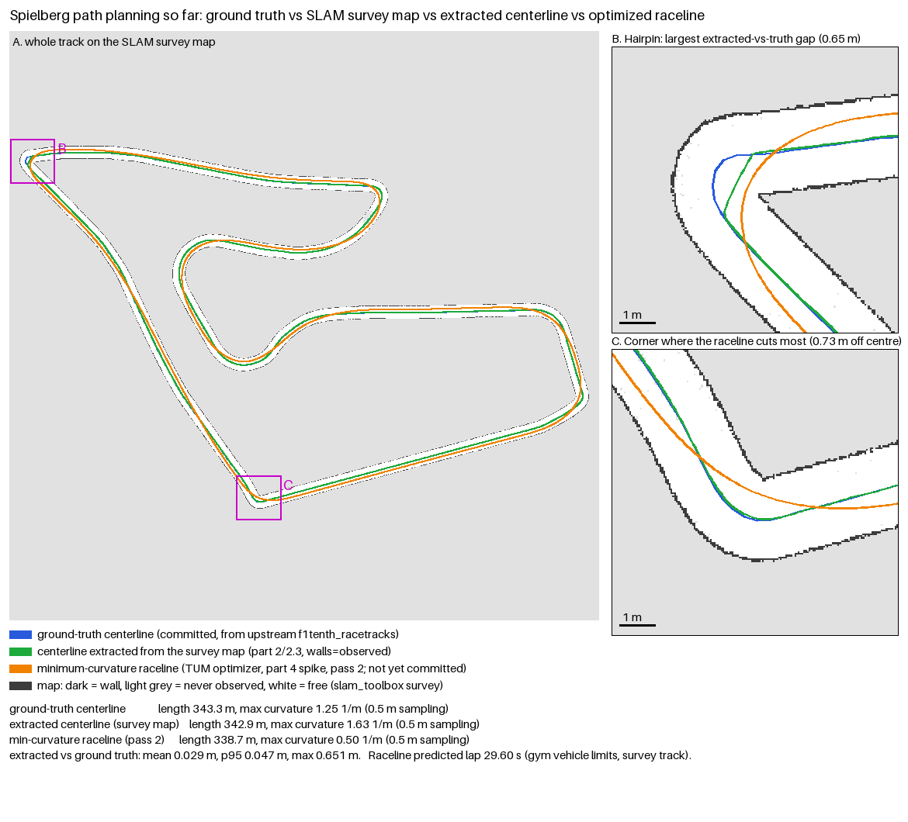

# Path planning

Where the path the car drives comes from, and how far each method has got. Track: Spielberg.

| | Source | Length | Max curvature (0.5 m sampling) |
|---|---|---|---|
| Ground-truth centerline | `config/tracks/spielberg.yaml`, imported from [f1tenth_racetracks](https://github.com/f1tenth/f1tenth_racetracks) | 343.3 m | 1.25 1/m |
| Survey map | `config/scenarios/maps/Spielberg/slam/`, built by slam_toolbox | — | — |
| Extracted centerline | `raceline.extract.extract_track(..., walls="observed")` on the survey map | 342.9 m | 1.63 1/m |
| Minimum-curvature raceline | TUM global race trajectory optimizer, `mincurv_iqp`, through `raceline.tum` | 338.7 m | 0.50 1/m |

## Ground-truth centerline

The committed track: upstream's centerline and its 1.1 m left and right widths. Pure Pursuit follows
it today, and lap distance is measured along it. It is not
available on an unseen map, which is why the methods below exist.

## Survey map

An occupancy grid slam_toolbox built while driving the track. Dark cells are walls, white is free,
grey was never observed. This is the only input the methods below are allowed on a real car.

## Centerline extracted from the map

`raceline/raceline/extract.py` finds the corridor between the two observed walls and returns its
centerline with left and right widths. Only walls the lidar saw count: the map frame and cells next
to unknown space are not walls, and a short unobserved gap is bridged under a turn and chord cap,
past which extraction raises rather than guess (see `raceline/README.md`).

Against the ground truth it is 0.029 m off on average and 0.047 m at the 95th percentile. The worst
point, 0.65 m, is the hairpin (zoom B): the extractor rounds off the sharp inner tip.

## Minimum-curvature raceline

The TUM global race trajectory optimizer (`mincurv_iqp`, run as a subprocess through
`raceline.tum`), given the extracted track, finds the line through the corridor with least
curvature (zoom C shows it using up to 0.73 m of the width at a corner). That halves the peak
curvature, and the line comes out 4.6 m shorter than the centerline. Its own estimate, with the
gym's vehicle limits, is a 29.60 s lap.

The orange line in the figure is from a measurement run, not a committed raceline: generating and
committing it, and the verifier that checks it against the ground-truth walls, are still in
progress. Nothing has yet driven it in the sim; that comparison is the next stage. It minimises
curvature, not distance; no shortest-path method is implemented.

The figure was produced at 07799a4 (2026-10-20).
