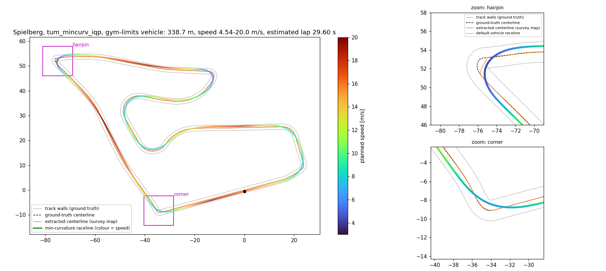

# Path planning

Where the path the car drives comes from, and how far each method has got. Track: Spielberg.

The gym-limits vehicle's minimum-curvature raceline, coloured by the speed it plans, against the
ground-truth centerline (dashed), the centerline extracted from the survey map (orange) and the
ground-truth walls. The zooms show the hairpin and the corner where the raceline cuts most; the
dotted line in them is the default vehicle's raceline.

| | Source | Length | Max curvature (0.5 m sampling) |
|---|---|---|---|
| Ground-truth centerline | `config/tracks/spielberg.yaml`, imported from [f1tenth_racetracks](https://github.com/f1tenth/f1tenth_racetracks) | 343.3 m | 1.25 1/m |
| Survey map | `config/scenarios/maps/Spielberg/slam/`, built by slam_toolbox | — | — |
| Extracted centerline | `raceline.extract.extract_track(..., walls="observed")` on the survey map | 342.9 m | 1.63 1/m |
| Minimum-curvature raceline | TUM global race trajectory optimizer, `mincurv_iqp`, through `raceline.tum` | 338.7 m | 0.50 1/m |
| Minimum-time raceline | the same optimizer's minimum-time mode on the owner's fork, seeded from the minimum-curvature line | see below | see below |

## Ground-truth centerline

The committed track: upstream's centerline and its 1.1 m left and right widths. Pure Pursuit follows
it today, and lap distance is measured along it. It is not
available on an unseen map, which is why the methods below exist.

## Survey map

An occupancy grid slam_toolbox built while driving the track. Dark cells are walls, white is free,
grey was never observed. This is the only input the methods below are allowed on a real car.

## Centerline extracted from the map

`raceline/raceline/extract.py` finds the corridor between the two observed walls and returns its
centerline with left and right widths. Only walls the lidar saw count: the map frame and cells next
to unknown space are not walls, and a short unobserved gap is bridged under a turn and chord cap,
past which extraction raises rather than guess (see `raceline/README.md`).

Against the ground truth it is 0.029 m off on average and 0.047 m at the 95th percentile. The worst
point, 0.65 m, is the hairpin (hairpin zoom): the extractor rounds off the sharp inner tip.

## Minimum-curvature raceline

The TUM global race trajectory optimizer (`mincurv_iqp`, run as a subprocess through
`raceline.tum`), given the extracted track, finds the line through the corridor with least
curvature (the corner zoom shows it using up to 0.73 m of the width at a corner). That halves the peak
curvature, and the line comes out 4.6 m shorter than the centerline. The optimizer's own estimate,
with the gym's vehicle limits, is a 29.60 s lap; that is an estimate, not a measured lap.

Raceline files are committed under `config/racelines/spielberg/` (one per vehicle version) and
`python -m raceline` produces them. The stack can race the default-vehicle line:
`planner:=optimized_raceline speed_source:=trajectory`. Measured in the sim (seed 42, 5x), that lap
takes 113.08 s against 120.41 s for the centerline lap. The comparison changes both the line and
the speed source: the raceline lap runs at the trajectory's flat 3.0 m/s, the centerline lap on the
controller's curvature schedule. 120.41 s is the headless golden; the live centerline lap measures
about 120.44 s. It minimises curvature, not distance; no
shortest-path method is implemented.

## Minimum-time raceline

The same optimizer's minimum-time mode, `tum_mintime`, solves for the fastest line the vehicle's
tyres and engine allow, in one solve seeded from the minimum-curvature line at the same 0.40 m
margin. IPOPT converges on both vehicles: 170 iterations (42 s) on the default vehicle, 1518
(328 s) on the gym-limits vehicle, whose estimated lap is 32.37 s. Both committed lines pass the
same verifier as the minimum-curvature ones.

The stack races the default-vehicle line with `planner:=optimized_raceline
raceline_optimizer:=tum_mintime speed_source:=trajectory`. Measured in the sim (seed 42, 5x), the lap
takes 112.12 s (seeds 42 and 7 differ by 0.01 s), against 113.08 s on the minimum-curvature line
and 120.41 s for the centerline lap. The default vehicle is limited to 3.0 m/s, so both lines run
at that speed and the 0.96 s is the shorter line. The optimizer's own estimate for the default
vehicle is 111.88 s, an estimate, not a measured lap. The nightly's four-seed comparison measured 112.07 to 112.19 s on the default vehicle, all
four laps completed. The gym-limits minimum-time line, like every gym-limits line, does not
finish a lap in the simulator (it leaves the track after 52 to 105 m), so no gate lap drives it.

The nightly drives every committed line on both vehicles and publishes the comparison as the
`raceline-report` artifact (see [Verification](verification.md)).

The figure was produced at a61e5fa (2026-10-22).
