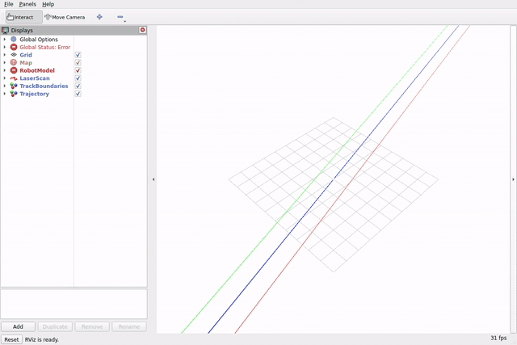

# Results

This page lists the measurements the repository publishes and where each one comes from.
`sim/rollout.py` generates the committed records headless on the GPU, and `racing_metrics`
computes the live record that is compared against them. They are **baseline regression data, not a leaderboard**: the
reference stack today is `ground_truth` pose, `track_centerline` (the centerline at constant
speed) and `pure_pursuit`, and none of it is tuned for speed. The numbers exist so that a
change in speed, tracking or wall clearance shows up in the tests. [Verification](verification.md)
lists the tests that check them.

## Baseline regression data

| Golden | Scenario / track | Seed | Lap completed | Lap time (s) | Collisions | Min wall clearance (m) | p95 / max tracking error (m) |
|---|---|---|---|---|---|---|---|
| `baseline.json` | `contract_test.yaml` / analytic circle | 42 | yes | 22.81 | 0 | 1.81 | 0.14 / 0.35 |
| `spielberg_baseline.json` | `spielberg.yaml` / Spielberg | 42 | yes | 120.41 | 0 | 0.89 | 0.03 / 0.21 |

The `scenario_id` field of the first record reads `baseline`, the metrics node's default, though
the scenario file is `contract_test.yaml`.

Both records were generated by `sim/rollout.py` on the GPU at commit `7ac3707`, driving on ground-truth
pose. Lap time is simulated time over one centerline lap, and the lap distance comes from the
track. The live ROS launch must reproduce each record within the tolerances in
`scripts/compare_metrics.py`: lap time 0.05 s, wall clearance 0.05 m and tracking error 0.01 m.
SIM-3040 and SIM-3090 check this, as described under
[System tests](verification.md#3-system-tests). A golden changes only as a reviewed diff, never to
make a run pass. The analytic circle is rotationally symmetric, so it is never used to judge
localization.

To reproduce a record and compare it, see [Running a scenario](running.md#running-a-scenario).

## Localization evidence

There is no golden for localization. The acceptance cases bound the estimate against ground truth on
Spielberg: `slam_toolbox` within 4.0 m RMSE and `amcl` within 0.65 m, each with availability above
0.99 (ACC-4030). `mola`, on MOLA's own map (so including that map's error), 1080 beams, 1x, open
loop: ATE RMSE 0.70-2.13 m and maximum 1.41-4.15 m over five laps (the spread is wide: it depends on the
host's load), availability 0.9975 or better, bounded at 2.5 m RMSE (ACC-4510, SIM-3510). A further case drives a full lap on the `amcl` estimate with zero collisions
(ACC-4040). See [Acceptance tests](verification.md#4-acceptance-tests-robot-framework).

## MOLA map accuracy

`./scripts/mola_map_track.sh` ([the MOLA map](workflows/mapping.md#the-mola-map)) builds a map from one
lap with no loop closure. Scored against the track's true walls (raw cell-centre distance, so a perfect
5 cm map scores 2.5 cm), ten laps of the current pipeline on Spielberg (seeds 7 and 42, 1x) gave a wall
95th-percentile deviation of 0.79-1.57 m, a median of 0.20-0.41 m and a mean offset of +0.077 to +0.160 m
(SIM-3530). The laps differ from each other because a lap without loop closure drifts differently each
time. The 5 cm wall target applies to the known-pose survey map only; a SLAM-built map is reported
against it, never gated, and misses it by 16 to 31 times. The committed map scores 0.82 m (95th
percentile) and 0.21 m (median).

The denser surveys beside the committed grid, measured against the track's ground-truth walls, have a
95th-percentile wall deviation of 0.067 m at 0.05 m cells, 0.049 m at 0.025 m and 0.046 m at 0.02 m
(`config/scenarios/maps/Spielberg/slam_0025/` and `slam_0020/`; their headers hold the full figures).

## Pose-source data

The nightly records every pose source on `spielberg` (64 beams) and `spielberg_1080` (1080 beams over
270 degrees), per seed, as `report.md` and `report.json` in the `pose-source-report` artifact of the
`slam` seed-42 job (SIM-5510 in [Verification](verification.md#5-nightly-coverage)). It reports the
estimate's error and availability, the rate of changed poses, the scan rate, CPU per scan and the produced
map's distance to the true walls. The wall distance is the raw distance from each occupied cell's centre
to the gym map image's wall faces, so a perfect map at 0.05 m cells scores 0.025 m, not 0. The report is
data: it ranks nothing and bounds no value. No numbers are published here until a nightly produces them.

## Mapping demonstration

The recording shows the real simulator, ROS and SLAM Toolbox path building the Spielberg grid
over a complete survey lap, at a playback acceleration disclosed beside it. The committed map is a
generated survey map: the vehicle drives on ground truth while SLAM Toolbox builds the grid
(`config/scenarios/maps/Spielberg/slam/Spielberg.yaml`). It is not an autonomous SLAM result. See
[Survey mapping](workflows/mapping.md#survey-mapping) for the command.

▶ [Watch the full video (Google Drive)](https://drive.google.com/file/d/1t3zhPOqS_hqWlyoussUel7uGPjXklRbF/view):
the complete survey lap at 4.0x simulated time (the preview above plays at 10.0x). Recorded with `ros2 launch racing_bringup slam_toolbox_mapping.launch.py scenario:=config/scenarios/spielberg_survey.yaml seed:=42`
on `config/scenarios/spielberg_survey.yaml`, seed 42, at commit `cadfdd5`.
